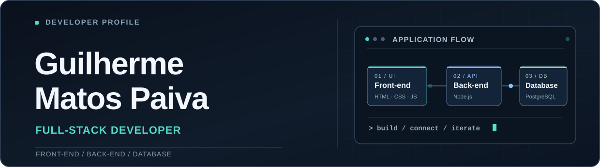

  

## Sobre mim

Sou **Guilherme Matos Paiva**, estudante de **Desenvolvimento de Software Multiplataforma** na **Fatec Jacareí**, com foco em desenvolvimento de software e aplicações web.

## Tecnologias e Ferramentas

**01 / FRONT-END**

**02 / BACK-END & DADOS**

**03 / DESENVOLVIMENTO**

**04 / DESIGN**

